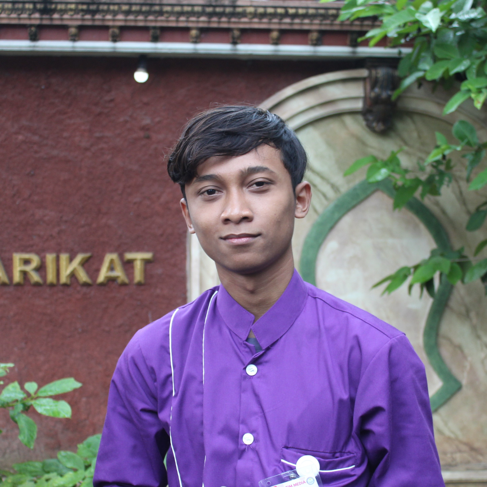

<div align="center">

# 🌸 Reyhan Haqiqi Portfolio



### Mobile & Web Developer | UI/UX Designer

[](https://reyqie.github.io)
[](https://github.com/reyqie)
[](https://www.linkedin.com/in/reyhan-haqiqi-a-f-a226b0248/)

*Informatics Graduate passionate about creating beautiful, functional digital experiences*

[View Portfolio](https://reyqie.github.io) • [Contact Me](mailto:reyhanfourniawan@gmail.com)

</div>

---

## ✨ Features

### 🎨 **Modern Design**
- **3 Dynamic Themes**: Sakura 🌸, Ocean 🌊, Space ✨
- **Glassmorphism UI** with smooth animations
- **Responsive Design** optimized for all devices
- **Custom Cursor** on desktop with interactive effects
- **Theme-Aware Sidebar** with staggered animations

### 📱 **Mobile-First Experience**
- Beautiful slide-in navigation with bounce effect
- Touch-optimized interactions
- No lag, butter-smooth 60fps performance
- Theme-adaptive design

### ⚡ **Performance Optimized**
- 60% particle reduction on load
- Lazy loading images for faster initial render
- GPU-accelerated animations
- Throttled scroll events with `requestAnimationFrame`
- Mobile-specific optimizations (disabled particles, parallax)

### 🔍 **SEO Optimized**
- Complete meta tags for social sharing
- Structured data (Schema.org JSON-LD)
- Sitemap & robots.txt included
- Open Graph & Twitter Cards support
- Optimized for "Reyhan Haqiqi" search ranking

---

## 🚀 Tech Stack

<div align="center">


</div>

### Core Technologies
- **Frontend**: Pure HTML5, CSS3, Vanilla JavaScript (No frameworks!)
- **Design**: Glassmorphism, CSS animations, Custom cursor
- **Performance**: RequestAnimationFrame, Lazy loading, Content-visibility
- **SEO**: Structured Data, Open Graph, Sitemap
- **Hosting**: GitHub Pages

---

## 📂 Project Structure

```
reyqie.github.io/
├── assets/
│   ├── img/
│   │   ├── favicon.png
│   │   ├── my-profile-img.JPG
│   │   └── portfolio/          # 40+ project images
│   └── files/                  # 7 certificates (PDF)
├── index.html                  # Main page with SEO
├── style.css                   # Core styling
├── mobile-theme.css            # Mobile sidebar themes
├── performance.css             # Performance optimizations
├── script.js                   # Main JavaScript
├── performance.js              # Performance enhancements
├── sitemap.xml                 # SEO sitemap
├── robots.txt                  # Crawler permissions
└── README.md                   # You are here!
```

---

## 🎯 Portfolio Sections

### 🏠 Hero
- Animated profile card with glassmorphic overlay
- Interactive theme particles (sakura, bubbles, stars)
- Smooth animations and scroll indicators

### 👨‍💻 About Me
- Professional introduction
- Tech stack showcase with icons
- Skills & expertise

### 💼 Projects (16 Total)
- **Mobile Apps** (7): Flutter projects including AI assistant, OCR app
- **Web Apps** (6): Laravel systems, e-commerce platforms
- **UI/UX Designs** (3): Figma mockups for job platforms, learning apps
- Click any project card to view detailed images in modal

### 📜 Certifications (7)
- AWS Cloud Fundamentals (Dicoding)
- Front-End Web Development (Dicoding)
- JavaScript Programming (Dicoding)
- Fullstack Laravel Flutter E-Commerce (BuildWithAngga)
- Future Jobs App Development (BuildWithAngga)
- Network Competency (Radnet)
- Mastering Flutter UI (BuildWithAngga)

### 📧 Contact
- Direct email link
- Social media integration (GitHub, LinkedIn, Instagram)
- Professional footer with quick links

---

## 🎨 Theme Showcase

<table>
<tr>
<td align="center">
  
  <br>
  <em>Pink gradient with falling sakura petals</em>
</td>
<td align="center">
  
  <br>
  <em>Cyan teal with bubbles & fish</em>
</td>
<td align="center">
  
  <br>
  <em>Purple gradient with stars & planets</em>
</td>
</tr>
</table>

---

## 🚀 Quick Start

### View Live
Visit **[reyqie.github.io](https://reyqie.github.io)** to see the portfolio in action!

### Run Locally

```bash
# Clone the repository
git clone https://github.com/reyqie/reyqie.github.io.git

# Navigate to directory
cd reyqie.github.io

# Open in browser (option 1 - direct)
open index.html

# OR run a local server (option 2 - recommended)
python -m http.server 8000
# Then visit: http://localhost:8000
```

No build process, dependencies, or installation required! Just pure HTML/CSS/JS.

---

## 📊 Performance Metrics

<div align="center">

| Metric | Desktop | Mobile |
|--------|---------|--------|
| **FPS** | 60fps | 60fps |
| **First Load** | < 2s | < 3s |
| **Particles** | 24 | 0 (disabled) |
| **Lighthouse** | 95+ | 90+ |

</div>

### Optimizations Applied
- ✅ Reduced particles by 60%
- ✅ Lazy loading for images
- ✅ GPU acceleration with `will-change`
- ✅ Throttled scroll events
- ✅ Content-visibility for images
- ✅ Mobile-specific optimizations

---

## 🎓 Skills & Expertise

### 📱 Mobile Development
- Flutter & Dart
- Android app development
- RESTful API integration
- State management

### 💻 Web Development
- PHP & Laravel framework
- MySQL database design
- Responsive web design
- Modern JavaScript (ES6+)

### 🎨 UI/UX Design
- Figma prototyping
- User-centered design
- Wireframing & mockups
- Design systems

---

## 📈 SEO Configuration

Portfolio is optimized for search engines:

```html
✅ Meta tags (title, description, keywords)
✅ Open Graph tags (Facebook sharing)
✅ Twitter Cards
✅ Structured Data (JSON-LD Schema.org)
✅ Canonical URLs
✅ Sitemap.xml
✅ Robots.txt
```

**Target Keywords:**
- Reyhan Haqiqi
- Flutter Developer Sidoarjo
- Laravel Developer Indonesia
- Mobile App Developer

---

## 🤝 Connect With Me

<div align="center">

[](mailto:reyhanfourniawan@gmail.com)
[](https://github.com/reyqie)
[](https://www.linkedin.com/in/reyhan-haqiqi-a-f-a226b0248/)
[](https://www.instagram.com/reyqieee/)

</div>

---

## 📝 License

This portfolio is open source. Feel free to fork and customize for your own use!

**Note**: Please replace personal information, images, and project details with your own.

---

## 🌟 Acknowledgments

- **Design Inspiration**: Modern glassmorphism trends
- **Icons**: Emoji-based for performance
- **Fonts**: System fonts for fast loading
- **Particles**: Custom JavaScript animations

---

<div align="center">

### 💖 Made with passion by Reyhan Haqiqi

⭐ Star this repo if you like it!

**Built in 2024 • Updated Monthly**

[↑ Back to Top](#-reyhan-haqiqi-portfolio)

</div>
